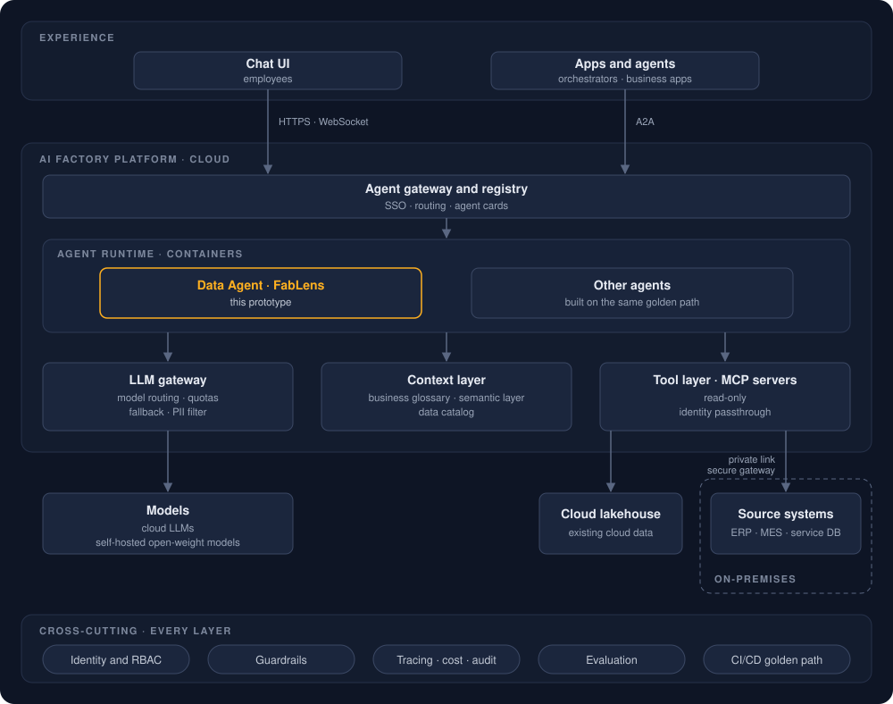

# Reference architecture: AI Factory

The AI Factory is the platform on which teams build, deploy and operate data-based AI agents. FabLens, the prototype in this repository, implements one building block of it: a Data Agent that answers questions about structured equipment and service data.

## 1. Decision: cloud-primary, on-premises data stays on-premises

- **Medium-sized company:** the platform team is small, so managed services take a large part of the operations work.
- **Fast-moving field:** new models arrive in the cloud first. Own GPUs are expensive, slow to procure and age quickly.
- **Part of the data already lives in the cloud.**
- **On-premises data stays where it is** (ERP, MES, service data, design IP). Tools run next to the data, and only query results cross a secure connection (private link or secure gateway).

## 2. Architecture

| Layer | Role | In the prototype |
| --- | --- | --- |
| Experience | Chat, API and other agents as clients | Chainlit chat UI and an A2A API on the same server |
| Agent gateway and registry | Authentication, routing, catalog of agent cards | Agent card at `/.well-known/agent-card.json`; no gateway, local use only |
| Agent runtime | Agents in containers, session state | One LangChain ReAct agent (`create_agent`), in-memory checkpointer per conversation, Docker image |
| LLM gateway | Model choice, quotas, cost, fallback | `init_chat_model` from environment variables: Groq primary, Gemini fallback; Ollama for on-premises |
| Tool layer | One MCP server per data source | Four in-process tools with MCP-ready signatures |
| Context layer | KPI definitions, data model, known data gaps | [glossary.yaml](../src/fablens/glossary.yaml) |
| Data | Lakehouse and on-premises databases | DuckDB, read-only connection |
| Evaluation, CI/CD | Quality gates, golden path | Unit tests and image build in GitHub Actions, eval set on demand |
| Observability | Tracing, cost, audit | Log lines per reply and per SQL query, fallback warnings |

The prototype has a single agent on purpose. Orchestration across agents belongs to the platform: other agents reach FabLens through its A2A interface and get a task state and a sources artifact back.

## 3. Data flow

1. A user asks a question in the chat after SSO, or another agent sends an A2A task.
2. The gateway authenticates the caller, looks up the Data Agent in the registry and forwards the request together with the user identity.
3. The agent loads the business definitions it needs from the context layer: glossary terms, KPI formulas, known data gaps.
4. It calls the model through the LLM gateway.
5. It calls the data tools **on behalf of the user**. A tool only reads, limits the rows and the run time, and runs next to the data; only the result set crosses the network.
6. Code, not the model, collects the sources: tables, executed SQL with row counts, glossary entries. Output guardrails check the answer. The reply carries an A2A task state: `completed`, `rejected` (controlled refusal: the data or a definition is missing) or `failed` (technical error).
7. Traces, cost and user feedback go to observability. Feedback cases extend the eval set.

## 4. Production aspects

- **Development:**
  - a golden-path template: agent skeleton, tool SDK, eval harness;
  - a sandbox with synthetic data;
  - prompts and glossary versioned in Git, reviewed by the data owners.
- **Deployment:**
  - CI/CD with quality gates: unit tests, eval threshold, security scans (code, secrets, dependencies, image);
  - container images with a pinned base, a non-root user and no dev dependencies;
  - dev, test and prod environments;
  - registration in the agent registry, with the agent card generated from code so it cannot drift.
- **Operations:**
  - OpenTelemetry tracing of model and tool calls, with PII masked before export;
  - latency, error rate and token cost per agent;
  - HTTP health probes;
  - a persistent store for sessions and tasks;
  - a regression eval on every model or prompt change.
- **Security:**
  - identity passthrough: the agent never sees more than the user;
  - least-privilege tools, read-only by default; write tools need human approval;
  - input size limits, rate limits per user and a tool call budget per request;
  - tool output is untrusted: prompt injection defenses and an egress allowlist;
  - secrets in a vault, TLS verification always on, private networking.
- **Governance:**
  - EU AI Act risk classification, GDPR;
  - an audit log of questions, tool calls and data access;
  - a named owner for each agent;
  - data classification decides where data may be processed.
- **Organization:** a platform team builds and runs the factory; use case teams build their agents on it.

## 5. Cloud or on-premises

| Aspect | Cloud | On-premises |
| --- | --- | --- |
| Models | Strongest models available immediately | Open-weight models only, on own GPUs |
| Time to start | Fast | Slow: hardware procurement, platform build |
| Scaling | Elastic | Fixed capacity |
| Cost | Pay per use (OpEx); expensive at high volume | Large investment (CapEx); cheaper under constant high load |
| Operations | Mostly handled by the provider | Own Kubernetes, GPU and MLOps team needed |
| Data and IP | Data leaves the site; manageable with an EU region, private endpoints, customer-managed keys and a no-training contract | Full control |
| Export control, compliance | Must be checked per data class | Easier to prove |
| Latency, edge | Depends on the WAN | Close to the machines, works offline |
| Lock-in | Can be high | Lower |

For an equipment manufacturer, export control is a key aspect: design data and customer data can be subject to export restrictions and contractual limits.

## 6. When on-premises is the better choice

- Data classification forbids the cloud, for example export-controlled design data or customer contracts.
- Air-gapped or offline environments: production sites, service machines.
- Constant, predictable high load, so own GPUs have the lower total cost.
- Open-weight models are good enough, and a strong platform team exists.

**Hybrid middle path:** for a strictly restricted data class, an on-premises inference node runs behind the same LLM gateway. Open standards (containers, MCP, A2A, OpenTelemetry) make the switch a configuration change, not a rewrite. In FabLens, switching to a local model means `LLM_MODEL=ollama:<model>`, without a code change.

## 7. From prototype to production

| Prototype | Production |
| --- | --- |
| Local use, no authentication | Gateway with SSO; user identity passed to the data source (row-level security) |
| In-memory conversations and tasks | Persistent session and task store |
| In-process tools | MCP servers next to each data source |
| `glossary.yaml` | Semantic layer and data catalog owned by data stewards |
| Free-tier model APIs | LLM gateway with enterprise contracts and an EU region |
| Log lines | OpenTelemetry tracing and cost dashboards |
| Eval on demand | Eval threshold as a CI gate on every model or prompt change |
| One container | Kubernetes with health probes and autoscaling |
